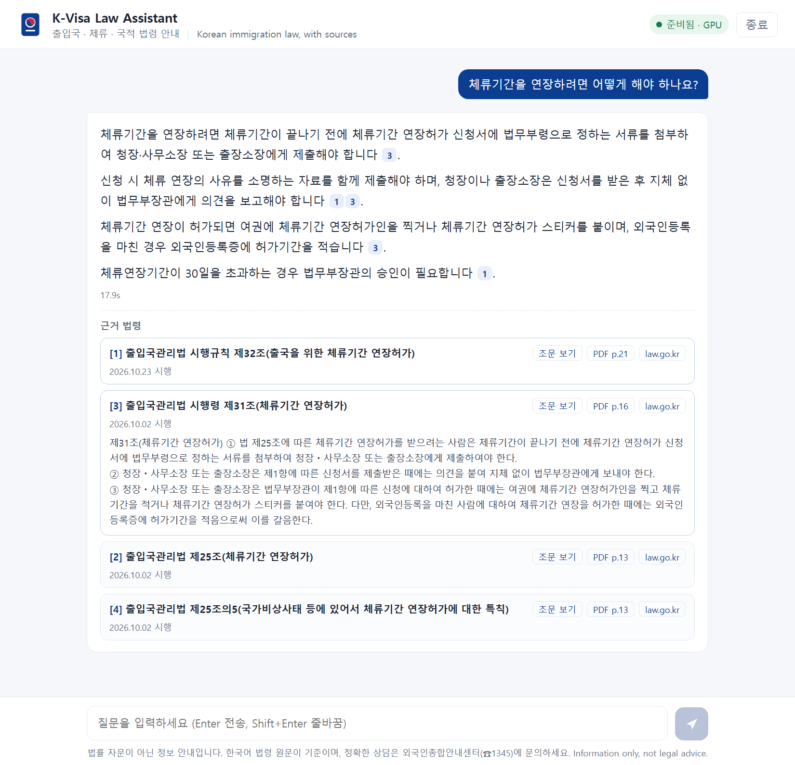
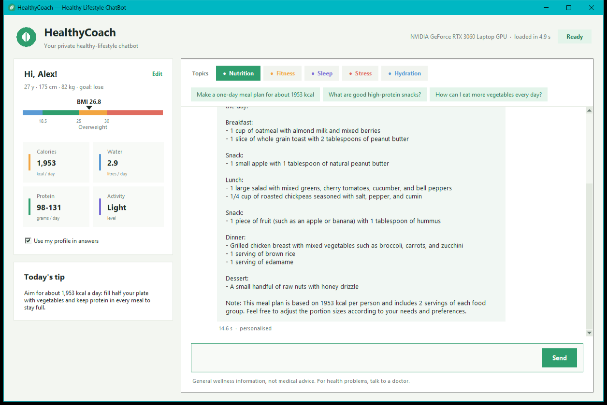
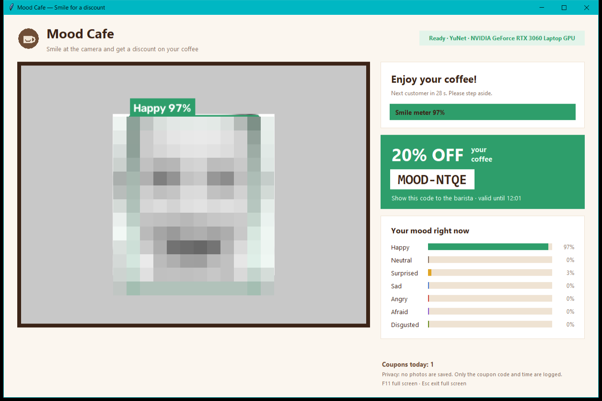
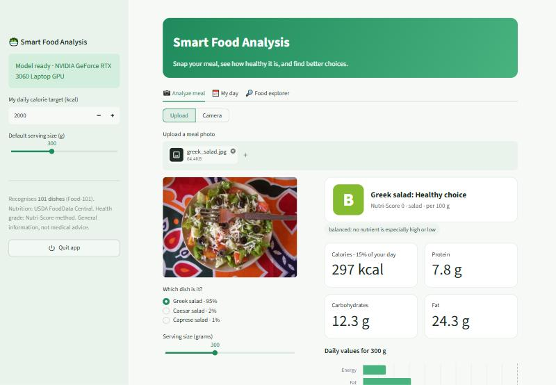
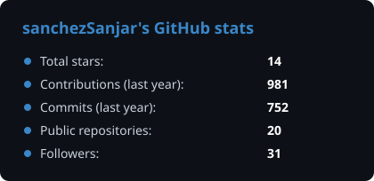
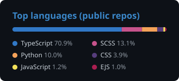

<p align="center">
  
</p>

<p align="center">
  <a href="https://www.carzip.kr"></a>
  <a href="https://detailstock.kr"></a>
  
</p>

## 👋 About me

- 📍 Full-stack AI engineer based in **South Korea**
- 🚀 Shipped **2 live products**: a used-car marketplace (web + mobile app) and a car-detailing online shop
- 🛠️ Building end to end: GraphQL API, database, web and mobile frontend, Docker deploy
- 🤖 Building **AI apps**: RAG, LLM fine-tuning, computer vision, forecasting
- 🖥️ Fine-tuning and running models locally on an **NVIDIA RTX 3060** laptop GPU (6 GB)
- 📏 Every AI project reports **real, measured results** and its limitations

```diff
@@  Right now  @@
+ Running carzip.kr: NestJS · GraphQL · Next.js
+ Building CarZip Mobile: Expo · chat · push
+ Running detailstock.kr: Express · React
+ Building AI apps: RAG, LLMs, vision

@@  Shipped  @@
+ CarZip: used-car marketplace, 4 languages
+ CarZip Mobile: photo + voice chat, push alerts
+ DetailStock: car-detailing e-commerce
+ K-Visa Law Assistant: RAG, 2026 HiKorea manuals
+ HealthyLifeStyle ChatBot: own LoRA fine-tune
+ JaydariGPT: TinyLlama LoRA, offline chat app
+ Mood Cafe: smile-for-a-discount kiosk, 90.8%
+ Smart Food: meal photo -> A-E health grade
+ Weather Daegu: NumPy forecasts, heatwaves x3.4
```

## 🧰 Languages and tools

**🎨 Frontend**<br/>
<br/>


**⚙️ Backend**<br/>
<br/>


**☁️ DevOps and cloud**<br/>
<br/>


**🧠 AI and machine learning**<br/>
<br/>


**📊 Data**<br/>


**🤖 Agentic AI integration**<br/>


## Live products

<table>
  <tr>
    <td width="50%" valign="top">
      <h3>🚗 CarZip</h3>
      <p>Used-car marketplace for Korea: verified dealers list cars, buyers search, compare, chat and book test drives. Web and mobile app in four languages.</p>
      <p><b>📱 New:</b> native mobile app for iOS and Android, <a href="#-carzip-mobile-app">see below</a></p>
      <p><b>Backend:</b> NestJS · GraphQL (Apollo) · MongoDB · Socket.io · Expo Push · Docker<br/><b>Frontend:</b> Next.js · MUI · i18n<br/><b>Mobile:</b> React Native · Expo Router · Apollo Client</p>
      <p>
        <a href="https://www.carzip.kr"></a>
        <a href="https://github.com/sanchezSanjar/CarZip"></a>
        <a href="https://github.com/sanchezSanjar/CarZip-next"></a>
        <a href="https://github.com/sanchezSanjar/CarZip_Mobile"></a>
      </p>
    </td>
    <td width="50%" valign="top">
      <h3>🧴 DetailStock</h3>
      <p>Online shop for professional car-detailing products with a premium dark design, responsive from phone to desktop, plus an admin panel.</p>
      <p><b>Backend:</b> Express · MongoDB · EJS admin<br/><b>Frontend:</b> React · Redux Toolkit · MUI · Vite</p>
      <p>
        <a href="https://detailstock.kr"></a>
        <a href="https://github.com/sanchezSanjar/detailStock"></a>
        <a href="https://github.com/sanchezSanjar/detailStock-react"></a>
      </p>
    </td>
  </tr>
</table>

## 📱 CarZip Mobile app

The <a href="https://www.carzip.kr">CarZip</a> marketplace as a native app for iOS and Android, on the same NestJS + GraphQL backend as the website. Built with Expo in TypeScript.

<table>
  <tr>
    <td width="50%" valign="top">
      <b>🚗 Cars</b><br/>
      Search, brand chips and filters (price, body type, fuel, sort)<br/>
      Car page with swipeable photos, likes and call / KakaoTalk buttons<br/>
      Test-drive booking: pick a day and time, message the dealer
    </td>
    <td width="50%" valign="top">
      <b>💬 Chat</b><br/>
      Live public chat room over WebSocket, auto-reconnect<br/>
      Private messages with dealers, read receipts ✓✓ and unread badge<br/>
      Photos from camera or gallery, voice messages up to 2 minutes
    </td>
  </tr>
  <tr>
    <td width="50%" valign="top">
      <b>🔔 Push and login</b><br/>
      Push notifications for messages, tap to open the right screen<br/>
      Secure login: 15-minute access token, rotating refresh token in the Keychain / Keystore
    </td>
    <td width="50%" valign="top">
      <b>🎨 Look and languages</b><br/>
      English, Korean, Russian and Uzbek<br/>
      Light / dark mode, smooth animations and haptics<br/>
      Yellow and black CarZip design
    </td>
  </tr>
</table>

<p>
  
  
  
  
  
  
</p>
<p>
  <a href="https://github.com/sanchezSanjar/CarZip_Mobile"></a>
  
</p>

## AI projects

<table>
  <tr>
    <td width="50%" valign="top">
      <a href="https://github.com/sanchezSanjar/K-Visa-Law-Assistant"></a>
      <h3><a href="https://github.com/sanchezSanjar/K-Visa-Law-Assistant">⚖️ K-Visa Law Assistant</a></h3>
      <p>Ask about Korean visa and immigration law in Korean or English; every answer cites the exact law article. RAG over 9 official laws, 18 visa tables, a Ministry of Justice guide and the <b>2026 HiKorea visa and stay manuals</b> (1,335 pages), fully offline on an RTX 3060.</p>
      <p><b>Result:</b> right article found for 95% of law questions; answers cite the right source for 94% of law and 93% of practical guide questions, in 13–17 s<br/><sub>bge-m3 · Qdrant · reranker · Qwen3-4B (4-bit) · FastAPI</sub></p>
    </td>
    <td width="50%" valign="top">
      <a href="https://github.com/sanchezSanjar/HealthyLifeStyle-ChatBot"></a>
      <h3><a href="https://github.com/sanchezSanjar/HealthyLifeStyle-ChatBot">💬 HealthyLifeStyle ChatBot</a></h3>
      <p>Offline healthy-lifestyle coach. Built my own 913-example health dataset and fine-tuned TinyLlama with LoRA on an RTX 3060 (11 minutes).</p>
      <p><b>Result:</b> held-out perplexity 3.00 → 2.75<br/><sub>PyTorch · PEFT/LoRA · Transformers · Tkinter</sub></p>
    </td>
  </tr>
  <tr>
    <td width="50%" valign="top">
      <a href="https://github.com/sanchezSanjar/MoodCafe"></a>
      <h3><a href="https://github.com/sanchezSanjar/MoodCafe">😊 Mood Cafe</a></h3>
      <p>Coffee-shop kiosk: smile at the camera and get a discount coupon. Face detection with OpenCV, expression recognition with a Vision Transformer.</p>
      <p><b>Result:</b> smile detection 90.8% on 3,589 test faces<br/><sub>OpenCV (YuNet) · ViT · PyTorch · Tkinter</sub></p>
    </td>
    <td width="50%" valign="top">
      <a href="https://github.com/sanchezSanjar/smart-food-analysis"></a>
      <h3><a href="https://github.com/sanchezSanjar/smart-food-analysis">🥗 Smart Food Analysis</a></h3>
      <p>Photo of a meal → dish, USDA nutrition and an A–E health grade (Nutri-Score), with healthier swaps and a daily meal diary.</p>
      <p><b>Result:</b> 92% top-1 dish recognition on 200 test photos<br/><sub>Vision Transformer · pandas · Streamlit</sub></p>
    </td>
  </tr>
  <tr>
    <td width="50%" valign="top">
      <a href="https://github.com/sanchezSanjar/Weather_Forecast_Daegu"></a>
      <h3><a href="https://github.com/sanchezSanjar/Weather_Forecast_Daegu">🌤️ Weather Forecast Daegu</a></h3>
      <p>26 years of Daegu weather: heatwave analysis and 7-day forecasts with ridge and logistic regression written from scratch in NumPy.</p>
      <p><b>Result:</b> heatwave days 10 → 35 per year; forecasts beat baselines<br/><sub>pandas · NumPy · Streamlit</sub></p>
    </td>
    <td width="50%" valign="top">
      <h3>🖥️ Built and run locally</h3>
      <p>All AI projects run on my own laptop with an <b>NVIDIA RTX 3060 (6 GB)</b>: LoRA fine-tuning, RAG search and 4-bit LLM answers, vision models and the dashboards. No paid APIs, and each project ships with a Windows <code>.exe</code> launcher.</p>
      <p> </p>
    </td>
  </tr>
</table>

## More projects

| Project | What it is | Stack |
|---|---|---|
| [Petoria](https://github.com/sanchezSanjar/petoria) · [web](https://github.com/sanchezSanjar/petoria-next) | Pet shop platform with API and batch services | NestJS · GraphQL · MongoDB · Next.js · three.js |
| [JaydariGPT](https://github.com/sanchezSanjar/jaydariGPT) | Team LLM: TinyLlama fine-tuned with LoRA (TRL), offline desktop chat and `.exe` launcher, GPU auto-setup | PyTorch · TRL · PEFT · Tkinter |
| [jaydari_rag](https://github.com/sanchezSanjar/jaydari_rag) | RAG API service (in progress) | FastAPI · Pydantic · Qdrant · TinyLlama |
| [Wooa Carwash](https://github.com/sanchezSanjar/wooa-carwash) | Car wash booking platform with a mobile app | NestJS · MongoDB · React Native (Expo) |
| [computer_vision](https://github.com/sanchezSanjar/computer_vision) | OpenCV, PyTorch and a food menu classifier (MobileNetV2, 89.5%) | OpenCV · PyTorch |
| [nestar-demo](https://github.com/sanchezSanjar/nestar-demo) | Property listing web demo, desktop and mobile layouts | Next.js · Apollo Client · Sass |
| [zoo](https://github.com/sanchezSanjar/zoo) | REST API server | NestJS |

## 📈 GitHub activity

<p align="center">
  
  
</p>

<p align="center">
  
</p>

<p align="center">
  <picture>
    <source media="(prefers-color-scheme: dark)" srcset="https://raw.githubusercontent.com/sanchezSanjar/sanchezSanjar/output/github-contribution-grid-snake-dark.svg" />
    
  </picture>
</p>


